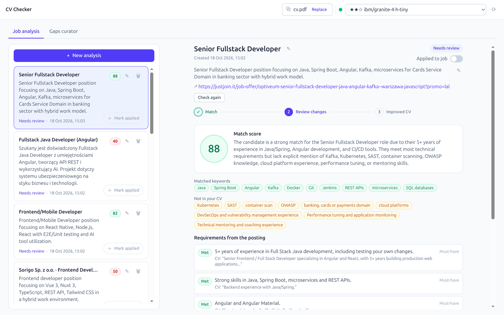
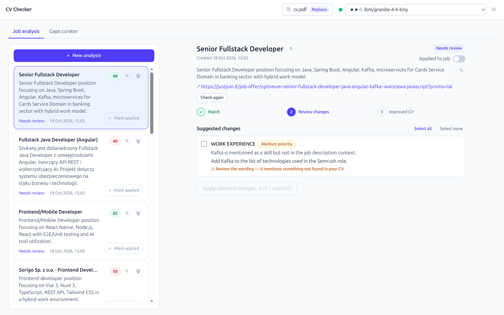
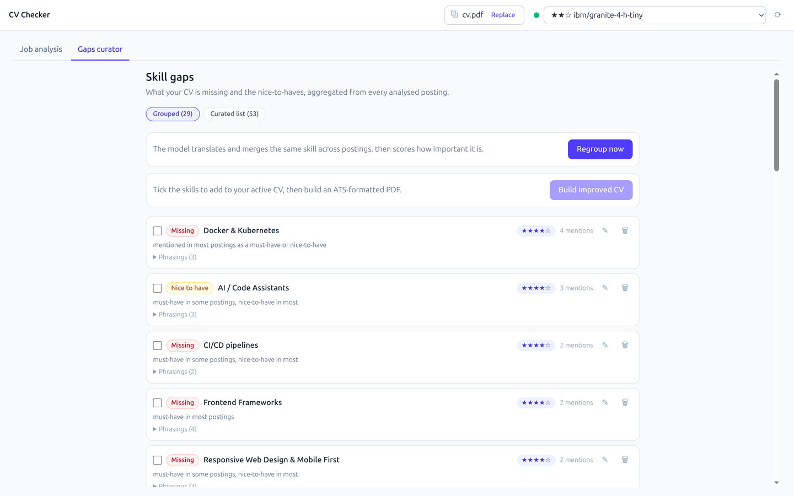

# CV Checker

Lokalny asystent aplikowania o pracę: wrzucasz CV w PDF, wybierasz model LLM działający w
[LM Studio](https://lmstudio.ai), a aplikacja ocenia dopasowanie CV do oferty, pokazuje braki i
proponuje zmiany. Po akceptacji wybranych poprawek generuje nowe, czytelne dla ATS CV w PDF.
Wszystko działa na Twoim komputerze — żadne dane nie opuszczają maszyny.



## Funkcje

- **Ocena dopasowania** — wynik 0–100, podsumowanie, dopasowane i brakujące słowa kluczowe oraz
  lista wymagań z oferty (must-have / nice-to-have / soft) z cytatami z CV.
- **Poprawa CV z akceptacją** — LLM proponuje konkretne zmiany (sekcja, przed/po, priorytet).
  Nic nie jest przepisywane bez Twojej zgody; model nie może wymyślać doświadczenia.
- **Nowe CV w PDF** — poprawione CV jest renderowane od zera w jednostronicowym szablonie ATS
  (tekst zaznaczalny, pełne polskie znaki, bez grafik i tabel).
- **Oferta z tekstu lub linku** — wklej opis lub podaj URL; serwer sam pobierze i oczyści stronę
  (JSON-LD → statyczny HTML → headless render).
- **Skill gaps** — braki z wszystkich analiz są agregowane, grupowane synonimami i oceniane pod
  kątem ważności; z wybranych umiejętności zbudujesz osobne CV.
- **Live updates** — jeden strumień SSE (`/api/events`) aktualizuje listę analiz, status modelu i
  CV we wszystkich otwartych kartach.
- **Trwałość** — analizy i braki są zapisywane w lokalnej bazie SQLite.




## Jak to działa

1. Raz wgrywasz CV (PDF z warstwą tekstową, max 5 MB). Backend od razu wyciąga tekst.
2. Wybierasz aktywny model w LM Studio (lista modeli jest pobierana z lokalnego serwera).
3. Dodajesz ofertę pracy — wklejasz tekst albo podajesz link.
4. Pipeline działa asynchronicznie: pobranie oferty → ocena → **pauza na Twoją akceptację** →
   przepisanie CV → wygenerowanie PDF.
5. Zaznaczasz proponowane zmiany i klikasz „Apply selected changes”. Gotowy plik pobierasz z karty
   analizy.

## Wymagania

| Narzędzie | Wersja |
|---|---|
| Java JDK | 21+ (projekt rozwijany i testowany na JDK 25) |
| Node.js | 22.22+ / 24.15+ / 26+ (Angular 22) |
| npm | 11+ |
| LM Studio | uruchomiony serwer lokalny z załadowanym modelem instruct/chat |
| Docker + Compose | opcjonalnie, do uruchomienia całości w kontenerach |

Maven nie jest wymagany — w repo jest `./mvnw`. LM Studio musi nasłuchiwać na
`http://localhost:1234` i mieć załadowany model. Sprawdź:

```bash
curl http://localhost:1234/v1/models
```

## Uruchomienie (dev)

### 1. Backend (`:8080`)

```bash
cd backend
LLM_MODEL=<model-id> ./mvnw spring-boot:run
```

`<model-id>` to dokładna nazwa modelu z odpowiedzi `GET /v1/models` (np.
`ista-daslab/qwen3.8-27b-gsq-rco-gguf/qwen3.8-27b-gsq-rco-iq3_s.gguf`). Model można też wybrać
później w UI — wtedy nie musisz ustawiać `LLM_MODEL`.

### 2. Frontend (`:4200`)

```bash
cd frontend
npm install
npm run start
```

Otwórz <http://localhost:4200>. Dev server proxuje `/api` na `http://localhost:8080`. Jeśli port
4200 jest zajęty: `npm run start -- --port 4300`.

### 3. Pierwsze kroki

1. Wgraj CV (przeciągnij PDF lub kliknij „Choose a file”).
2. Wybierz model w pasku u góry — status musi być zielony („active model”).
3. Kliknij **New analysis**, wklej ofertę lub podaj link i uruchom analizę.

## Uruchomienie w Dockerze

LM Studio zostaje na hoście — kontenery łączą się z nim przez `host.docker.internal`.

W LM Studio włącz **Serve on Local Network** (serwer musi nasłuchiwać na `0.0.0.0:1234`, nie tylko
na `127.0.0.1`).

```bash
cp .env.example .env     # ustaw LLM_MODEL na nazwę załadowanego modelu
docker compose up --build
```

Frontend: <http://localhost:4200>, backend: `http://localhost:8080`. Baza SQLite żyje w wolumenie
`backend-data`, więc analizy przetrwają restart (`docker compose down -v` je usuwa). Porty można
zmienić przez `BACKEND_PORT` / `FRONTEND_PORT` w `.env`.

## Konfiguracja

| Zmienna | Domyślnie | Znaczenie |
|---|---|---|
| `LLM_MODEL` | `unconfigured` | ID modelu z LM Studio; można też wybrać w UI |
| `LLM_BASE_URL` | `http://localhost:1234/v1` | endpoint OpenAI-compatible (**musi kończyć się `/v1`**) |
| `LM_STUDIO_BASE_URL` | `http://localhost:1234` | natywne API LM Studio (**bez** `/v1`) |
| `CV_DB_PATH` | `./data/cvchecker.db` | plik bazy SQLite |
| `SPRING_AI_OPENAI_API_KEY` | `lm-studio` | placeholder; LM Studio go ignoruje |

Pozostałe parametry (timeouty, liczba równoległych analiz, TTL, limity pobierania ofert) są w
`backend/src/main/resources/application.yml`.

## Stack

| Warstwa | Technologia |
|---|---|
| Frontend | Angular 22 (standalone, signals, zoneless), Tailwind CSS 4, Vitest |
| Backend | Java 21, Spring Boot 4.1, Spring MVC, virtual threads |
| LLM | Spring AI 2.0 → LM Studio (OpenAI-compatible API) |
| Push | SSE (`SseEmitter`, jeden globalny strumień) |
| PDF | Apache PDFBox 3 (ekstrakcja i render, osadzony DejaVu Sans) |
| Dane | SQLite (`sqlite-jdbc` + Spring JDBC) |

## Testy

```bash
# backend — testy live z LM Studio są pomijane bez LM_STUDIO_LIVE=1
cd backend
./mvnw test
LM_STUDIO_LIVE=1 LLM_MODEL=<model-id> ./mvnw test

# frontend
cd frontend
npm run lint
npm run build
npx ng test --watch=false
```

## Struktura projektu

```
backend/     Spring Boot API, pipeline analizy, LLM, PDF, SQLite
frontend/    Angular SPA (workspace: analizy, CV, model, skill gaps)
docs/        API.md (kontrakt REST/SSE), DECISIONS.md, ENVIRONMENT.md, screenshots/
PLAN.en.md   plan implementacji i architektura
```

## Dokumentacja

- [`docs/API.md`](docs/API.md) — pełny kontrakt REST/SSE (źródło prawdy dla zmian API).
- [`docs/DECISIONS.md`](docs/DECISIONS.md) — dziennik decyzji technicznych.
- [`PLAN.en.md`](PLAN.en.md) — plan i architektura (częściowo historyczny).
