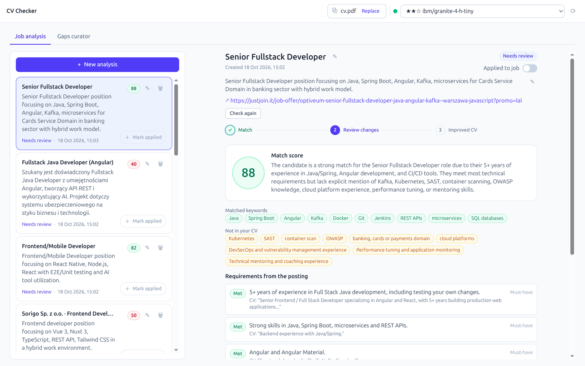

# CV Checker

A local job-application assistant: upload your CV as a PDF, pick an LLM served by
[LM Studio](https://lmstudio.ai), and the app scores how well the CV matches a job posting, shows
the gaps, and suggests concrete changes. Once you approve the edits, it renders a new ATS-friendly
PDF. Everything runs on your machine — no data leaves it.



## Features

- **Match score** — a 0–100 score, a summary, matched/missing keywords, and the posting's
  requirements (must-have / nice-to-have / soft) with evidence quoted from the CV.
- **Review-before-rewrite** — the LLM proposes concrete edits (section, before/after, priority).
  Nothing is rewritten without your approval, and the model may not invent experience.
- **New PDF** — the improved CV is rendered from scratch with a single-page ATS template
  (selectable text, full Polish character set, no graphics or tables).
- **Posting from text or a link** — paste the description or provide a URL; the server fetches and
  cleans the page itself (JSON-LD → static HTML → headless render).
- **Skill gaps** — missing skills from every analysis are aggregated, grouped by synonym, and
  ranked by importance; selected skills can drive a standalone CV build.
- **Live updates** — a single SSE stream (`/api/events`) keeps the analyses, model status, and CV
  in sync across open tabs.
- **Persistence** — analyses and skill gaps are stored in a local SQLite database.


## How it works

1. Upload your CV once (a PDF with a text layer, max 5 MB). The backend extracts the text
   immediately.
2. Select the active model in LM Studio (the model list comes from the local server).
3. Add a job posting — either paste the text or provide a link.
4. The pipeline runs asynchronously: fetch posting → evaluate → **pause for your approval** →
   rewrite the CV → generate the PDF.
5. Tick the suggested changes and click “Apply selected changes”. Download the result from the
   analysis card.

## Requirements

| Tool | Version |
|---|---|
| Java JDK | 21+ (developed and tested on JDK 25) |
| Node.js | 22.22+ / 24.15+ / 26+ (Angular 22) |
| npm | 11+ |
| LM Studio | local server running with a loaded instruct/chat model |
| Docker + Compose | optional, for running everything in containers |

Maven is not required — the repo includes `./mvnw`. LM Studio must listen on
`http://localhost:1234` with a model loaded. Verify it with:

```bash
curl http://localhost:1234/v1/models
```

## Run (dev)

### 1. Backend (`:8080`)

```bash
cd backend
LLM_MODEL=<model-id> ./mvnw spring-boot:run
```

`<model-id>` is the exact name from the `GET /v1/models` response (e.g.
`ista-daslab/qwen3.8-27b-gsq-rco-gguf/qwen3.8-27b-gsq-rco-iq3_s.gguf`). You can also select a model
later in the UI, in which case `LLM_MODEL` is not required.

### 2. Frontend (`:4200`)

```bash
cd frontend
npm install
npm run start
```

Open <http://localhost:4200>. The dev server proxies `/api` to `http://localhost:8080`. If port
4200 is taken: `npm run start -- --port 4300`.

### 3. First steps

1. Upload your CV (drag a PDF or click “Choose a file”).
2. Pick a model in the top bar — its status must be green (“active model”).
3. Click **New analysis**, paste a posting or provide a link, and start the analysis.

## Run with Docker

LM Studio stays on the host — containers reach it through `host.docker.internal`.

In LM Studio, enable **Serve on Local Network** (the server must bind `0.0.0.0:1234`, not just
`127.0.0.1`).

```bash
cp .env.example .env     # set LLM_MODEL to your loaded model id
docker compose up --build
```

Frontend: <http://localhost:4200>, backend: `http://localhost:8080`. The SQLite database lives in
the `backend-data` volume, so analyses survive restarts (`docker compose down -v` wipes them).
Override ports with `BACKEND_PORT` / `FRONTEND_PORT` in `.env`.

## Configuration

| Variable | Default | Meaning |
|---|---|---|
| `LLM_MODEL` | `unconfigured` | LM Studio model id; can also be selected in the UI |
| `LLM_BASE_URL` | `http://localhost:1234/v1` | OpenAI-compatible endpoint (**must end in `/v1`**) |
| `LM_STUDIO_BASE_URL` | `http://localhost:1234` | LM Studio native API (**without** `/v1`) |
| `CV_DB_PATH` | `./data/cvchecker.db` | SQLite database file |
| `SPRING_AI_OPENAI_API_KEY` | `lm-studio` | placeholder; LM Studio ignores it |

Other settings (timeouts, analysis concurrency, TTL, posting-fetch limits) live in
`backend/src/main/resources/application.yml`.

## Stack

| Layer | Technology |
|---|---|
| Frontend | Angular 22 (standalone, signals, zoneless), Tailwind CSS 4, Vitest |
| Backend | Java 21, Spring Boot 4.1, Spring MVC, virtual threads |
| LLM | Spring AI 2.0 → LM Studio (OpenAI-compatible API) |
| Push | SSE (`SseEmitter`, one global stream) |
| PDF | Apache PDFBox 3 (extraction and rendering, embedded DejaVu Sans) |
| Data | SQLite (`sqlite-jdbc` + Spring JDBC) |

## Tests

```bash
# backend — live LM Studio tests are skipped unless LM_STUDIO_LIVE=1
cd backend
./mvnw test
LM_STUDIO_LIVE=1 LLM_MODEL=<model-id> ./mvnw test

# frontend
cd frontend
npm run lint
npm run build
npx ng test --watch=false
```

## Project structure

```
backend/            Spring Boot API, analysis pipeline, LLM, PDF, SQLite
frontend/           Angular SPA (workspace: analyses, CV, model, skill gaps)
assets/screenshots/ Images used by this README
```
